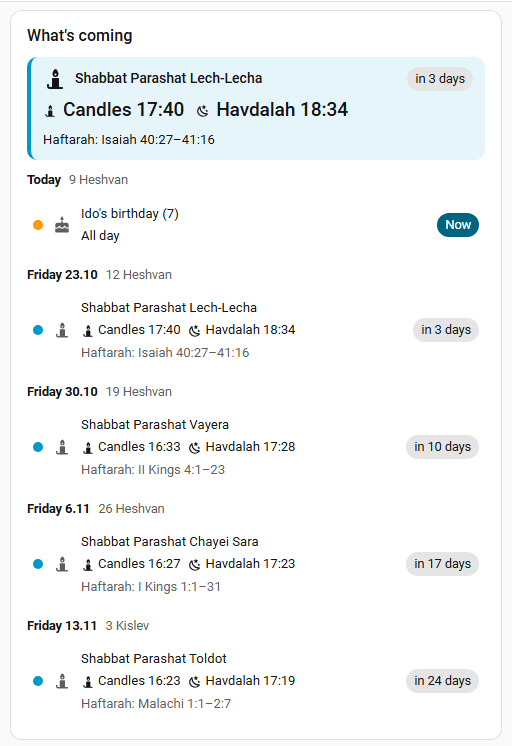
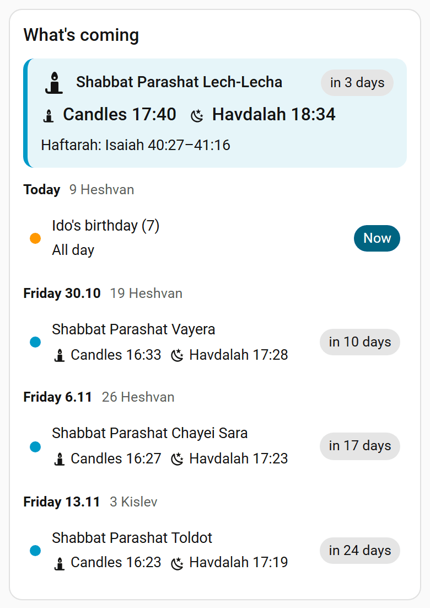

# Card

`custom:good-days-card` shows a merged agenda: Shabbat, holidays, fasts, your family dates and any other calendars, with countdowns, Hebrew dates and candle lighting times. External and family events that fall on Shabbat or Yom Tov get a warning badge. Tap a row for details.

Everything is editable in the visual editor. The card follows the user's Home Assistant language (Hebrew gives RTL).





## YAML

The card resource is registered automatically on storage-mode dashboards. On YAML-mode dashboards, add `/good_days_static/card.js` as a JavaScript module.

```yaml
type: custom:good-days-card
title: What's coming          # optional
calendars:                    # external calendars to merge
  - calendar.family
  - calendar.school
colors:                       # optional, per source ("holidays", "family", or a calendar)
  calendar.family: "#4caf50"
days: 30                      # look-ahead, 1-400
limit: 10                     # items, 1-100
categories: [shabbat, yom_tov, minor, fast, family]   # optional, default = integration options + family
show_hebrew_date: true
show_candle_lighting: true
show_haftarah: true           # "Haftarah: ..." line under Shabbat rows and in the next-Shabbat box
show_omer: true               # during the Omer, a line with today's count
compact: false                # one line: "Next: Shabbat · in 2 days · candles 17:52"
responsive: true              # show less when the card is narrow
narrow_limit: 3               # events listed in a narrow card
location:                     # optional: this card's own place (default: the integration's)
  latitude: 32.50
  longitude: 34.89
candle_lighting: 30           # optional: minutes before sunset (default: the integration's)
havdalah: 0                   # optional: minutes after sunset, 0 = three stars
diaspora: false               # optional: two-day Yom Tov (default: the integration's)
entry_id: <optional, for a second Good Days instance>
```

## Responsive layout

The card adapts to its own width, not the screen's, so a card in a narrow column or a small sections cell shows less:

| Width | What you see |
|---|---|
| **Wide**, 400 px and up | Everything. |
| **Medium**, 280 to 399 px | No category icons and no haftarah line under list rows; the next Shabbat / Yom Tov is not repeated below its summary box. |
| **Narrow**, under 280 px | Also no Hebrew dates, no haftarah in the summary box and no secondary notes. The countdown moves onto the time line, and the list stops at `narrow_limit` events. |

Tapping a row still shows everything. Set `responsive: false` to always show the full card. In a sections view the card can be resized down to 3 columns.

## Own location and times

Turn on **Own location and times for this card** in the editor to show another place (the parents' city, a holiday home) or a local custom (for example Jerusalem 40 minutes, Haifa 30) on one card. Pick the spot on the map and optionally set candle lighting, havdalah and one or two days of Yom Tov. Anything left empty follows the integration.

Only that card changes: sensors, timers, reminders and Assist keep the integration's settings. Times are shown in Home Assistant's time zone, so pick places in the same zone, or use a second Good Days instance there (then set `entry_id`).

## Fasts, Omer and haftarah

- A fast in progress counts down to its end ("ends in 1:12"), and fast rows show when they begin and end.
- During the Omer a line shows today's count (`show_omer`).
- Each Shabbat shows its haftarah, for example "Haftarah: Isaiah 54:1-55:5" (`show_haftarah`). When Shabbat runs together with Yom Tov the label reads "Shabbat haftarah".

!!! info "Without the integration"
    The card still lists the selected calendars (no holidays) and shows a hint.
