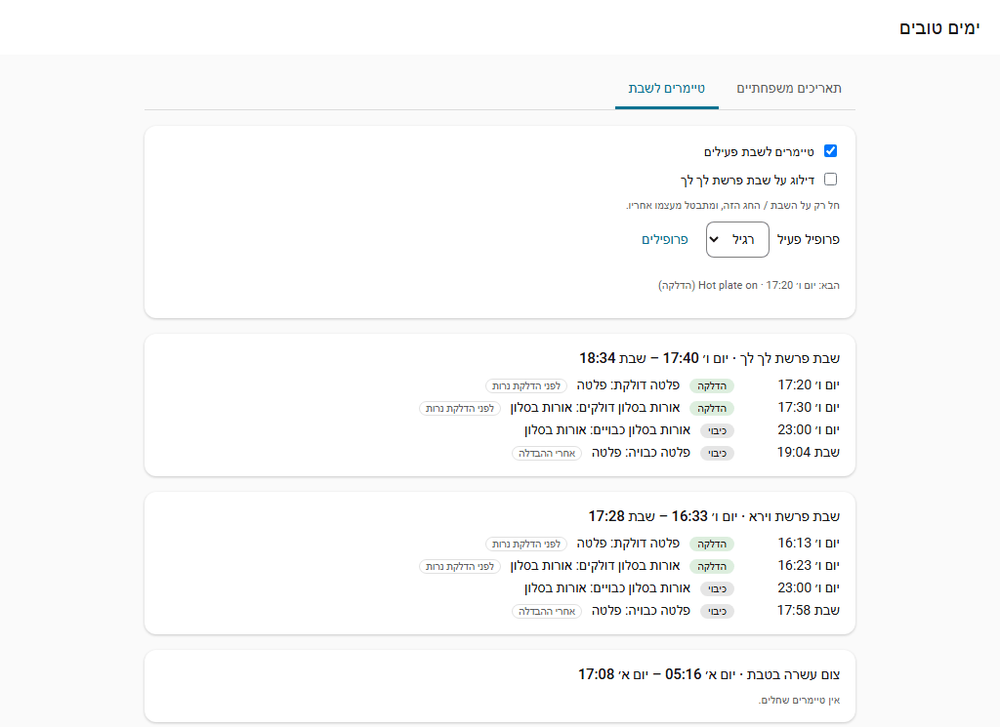

# טיימרים לשבת

פותחים את **ימים טובים** בסרגל הצד ובוחרים בלשונית **טיימרים לשבת**. כל טיימר **מדליק או מכבה** מכשירים: מתגים, תאורה, שקעים חכמים, מאווררים, מזגן, דודי מים, סצנות ודומיהם. סקריפטים, אוטומציות, מנעולים, תריסים וברזים לא מוצעים.

## מתי טיימר פועל

- **סביב הדלקת נרות** או **סביב הבדלה**: N דקות לפני או אחרי. למשל, פלטה נדלקת 20 דקות לפני הדלקת נרות ונכבית 30 דקות אחרי ההבדלה.
- **בשעה קבועה בכל יום קדוש**: למשל תאורה נכבית ב-23:00 ונדלקת ב-07:00. שעה מאוחרת מהדלקת הנרות פירושה הערב שלפני (23:00 היא ליל שבת); שעה מוקדמת יותר היא ביום עצמו. אפשר לבחור כל יום, היום הראשון או האחרון, או ערב (היום שלפני).

## חל על

שבת, יום טוב, יום כיפור ו/או ימי צום. פלטה, למשל, בדרך כלל לא צריכה לחול על יום כיפור. חג של שניים או שלושה ימים יחד עם שבת מטופל כרצף אחד.

ביום צום, "הדלקת נרות" פירושה מתי הצום מתחיל, ו"הבדלה" מתי הוא מסתיים. שעה קבועה בצום קל חלה באותו יום.

## תנאים

השדה האופציונלי **Only if** מקבל תנאים של Home Assistant, שנבדקים ברגע שהטיימר פועל, למשל רק כשיש אורחים.

## תבניות מוכנות

תבניות מוכנות יוצרות עבורכם את טיימרי ההדלקה והכיבוי:

- פלטה, מיחם
- תאורה בערב, תאורה בבוקר
- מזגן
- דוד חשמלי (נדלק בצהריים בערב שבת או חג, נכבה לפני הדלקת נרות; הוא מחמם רק בערב של חג רב-יומי)
- תאורת כניסה (נדלקת לפני הדלקת נרות, נכבית ב-01:00)
- מזגן בחדר השינה בלילה (22:00 עד 06:30)
- סיום הצום (מיחם או קומקום נדלקים 30 דקות לפני סוף הצום ונכבים שעה אחריו)

בחלון התבנית מופיע סיכום של מה ייווצר, לפני שמאשרים.

## פרופילים

פרופילים (למשל רגיל, אורחים, קיץ) מחזיקים קבוצות נפרדות של טיימרים. פרופיל אחד פעיל, והוא מוצג ב-`select.good_days_timer_profile`. פרופיל חדש יכול להתחיל כעותק של אחר, אפשר לשנות שמות של פרופילים, ואפשר לצפות ולערוך פרופיל אחר בלי להפוך אותו לפעיל. **Duplicate** משכפל טיימר בודד.

## תצוגה מקדימה, התנגשויות ובדיקה

הלשונית מציגה **תצוגה מקדימה** של השבת או החג הבא: כל פעולה עם השעה המדויקת שלה (הרצה יבשה), עם סימון אם היא לפני הדלקת הנרות או אחרי ההבדלה. היא מדווחת על **התנגשויות** כשאותו מכשיר מודלק ומכובה באותה דקה; שום דבר לא נפתר עבורכם. **Run now** בודק טיימר מיד. ההיסטוריה שומרת את 100 ההרצות האחרונות.

## כללי התנהגות

- כל פעולה רצה **פעם אחת**. שינוי ידני שנעשה אחר כך נשאר כמו שהוא.
- אם Home Assistant לא פעילה כשהגיע זמן הפעולה, היא עדיין תרוץ אם האיחור הוא **10 דקות** לכל היותר. פעולות ישנות יותר מדולגות ומסומנות כ-*missed*.
- **Skip next Shabbat / Chag** (`switch.good_days_skip_next_shabbat_or_chag`) מבטל את הטיימרים של אותה שבת או אותו חג בלבד, ואז מתאפס מעצמו.
- `switch.good_days_shabbat_timers` מפעיל או מכבה את כל הטיימרים ושומר את הכללים.
- `sensor.good_days_next_timer_action` מראה מתי הפעולה הבאה תרוץ, עם המאפיינים `rule`, `action` ו-`targets`.
