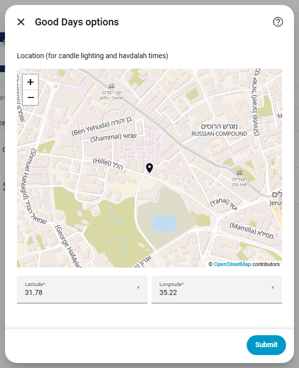
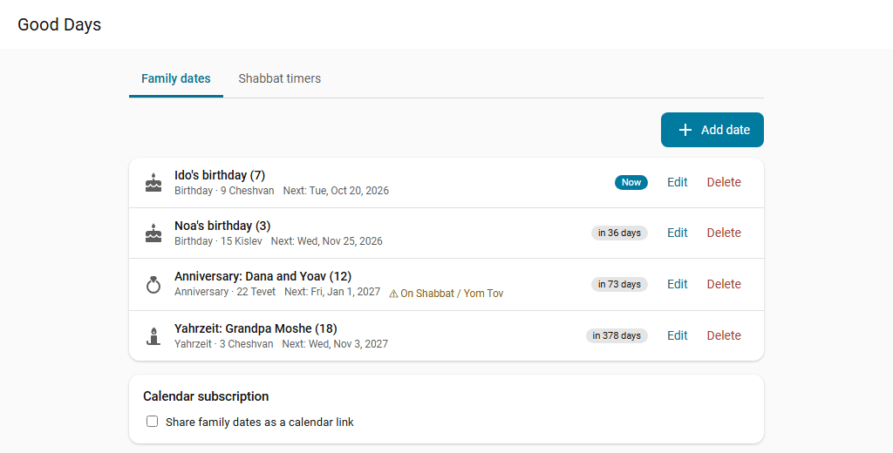

# Usage

## Settings




Open **Settings → Devices & services → Good Days → Configure**. The options cover:

- Location, candle lighting and havdalah minutes, and Israel or diaspora (one or two days of Yom Tov).
- The language of event names (Hebrew, English, or the Home Assistant language). The sidebar title follows this option too.
- The categories shown on `calendar.good_days_holidays`, and how far ahead to look.
- The haftarah custom: **Sephardi / Edot HaMizrach** (the default for new installs) or **Ashkenazi**. The customs differ on about one Shabbat in four. Installs set up before v0.7 keep Ashkenazi until you change it.
- When minor fasts begin (dawn at 16.1 degrees, the default, or 72 or 90 minutes before sunrise) and end (nightfall at 6.45 degrees, the default, or your havdalah setting). Tisha B'Av and Yom Kippur always end at havdalah.
- Reminders, see below.

### Holiday categories

`shabbat`, `yom_tov`, `chol_hamoed`, `minor` (Chanukah, Purim, Tu BiShvat, Lag BaOmer...), `fast`, `rosh_chodesh`, `modern` (Yom HaAtzmaut, Yom HaZikaron, Yom HaShoah, Yom Yerushalayim), `memorial` (other memorial and national days) and `erev` (Erev Yom Tov days). The default is the first five plus `modern`.

## Family dates




Open **Good Days** in the sidebar (all users). Add a birthday, yahrzeit, anniversary or other date by its Hebrew date, or type the Gregorian date (tick *after sunset* if it was after sunset) and it is converted. When you give the Hebrew year, the title shows the age or the number of years, for example "Noa's birthday (7)".

Rules per date. The defaults are common customs; communities differ, so check yours.

- **Plain Adar in a leap year**: birthdays and anniversaries fall in Adar II, yahrzeits in Adar I; or pick Adar I, Adar II or both.
- **Dates in Adar I / Adar II** fall in plain Adar in a regular year.
- **30 Cheshvan / 30 Kislev** in a year where the month has 29 days: the 1st of the next month (the first day of Rosh Chodesh), or the 29th. **30 Adar I** in a plain year: 30 Shvat (the first day of Rosh Chodesh Adar), or 29 Adar.

Birthdays and anniversaries are all-day events. A yahrzeit runs from sunset the evening before to sunset.

### Services

`good_days.add_date`, `good_days.update_date`, `good_days.remove_date` and `good_days.list_dates` (returns every date with its next occurrence).

```yaml
action: good_days.add_date
data:
  name: Saba Moshe
  kind: yahrzeit
  hebrew_day: 3
  hebrew_month: marcheshvan   # tishrei ... elul; adar = Adar of a plain year; adar_i / adar_ii
  original_year: 5770
```

Data is stored per instance in `.storage/good_days.<entry_id>`.

## Reminders

In **Configure**:

- **Send family-date reminders to**: notify services, for example `mobile_app_my_phone`. Phones get **Got it** and **Remind me tomorrow** buttons.
- **Reminder time** (default 09:00).
- **Hold reminders during Shabbat and Yom Tov** (default on): a reminder due then is sent an hour before candle lighting instead.

Each family date chooses when to remind in the panel: on the day, or 1, 3 or 7 days before (any value from 0 to 60 through the services). For a yahrzeit, "on the day" means the evening it begins, an hour before sunset, with the time to light the candle. If the yahrzeit begins on Shabbat or Yom Tov, the message says to light before candle lighting; if it begins as Shabbat ends, after havdalah.

### Omer reminder

Off by default. Turn on **Remind me to count the Omer** and set the minutes after nightfall. Every night of the Omer you get "Tonight: day N of the Omer", the counting sentence and a **Counted** button, sent to the same targets. The event `good_days_omer` is fired, see [Events](entities.md#events).

## Calendar link (ICS)

Admins can open the panel and use **Share family dates as a calendar link**. Optional switches: **Include Shabbat and holidays**, and **Include family notes** (off by default; the notes become visible to the calendar provider).

Copy the link into Google Calendar (*Other calendars → From URL*) or Outlook, or open it on a phone with *Open in calendar app*. The feed covers 30 days back to 2 years ahead and refreshes every 12 hours.

!!! warning "Anyone with the link can read the dates"
    The link works without logging in; the long random part is the key. **New link** replaces it and the old one stops working. Turning sharing off disables the link.

!!! note "External address needed"
    Google Calendar fetches from the internet, so the link must use an external address (Home Assistant Cloud, or your external URL from *Settings → System → Network*).

## Who can change what

Everyone sees the family dates and the Shabbat timers. Only admins can change the timers, the calendar link and the timer entities (switches and the profile select). Automations can still use those entities.
